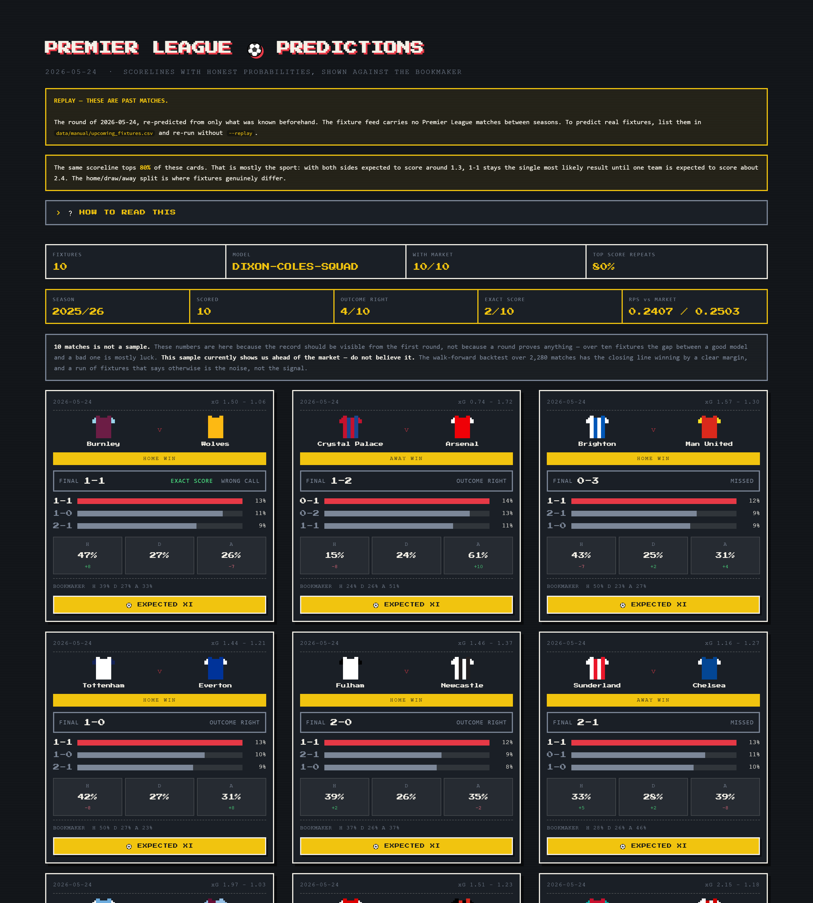
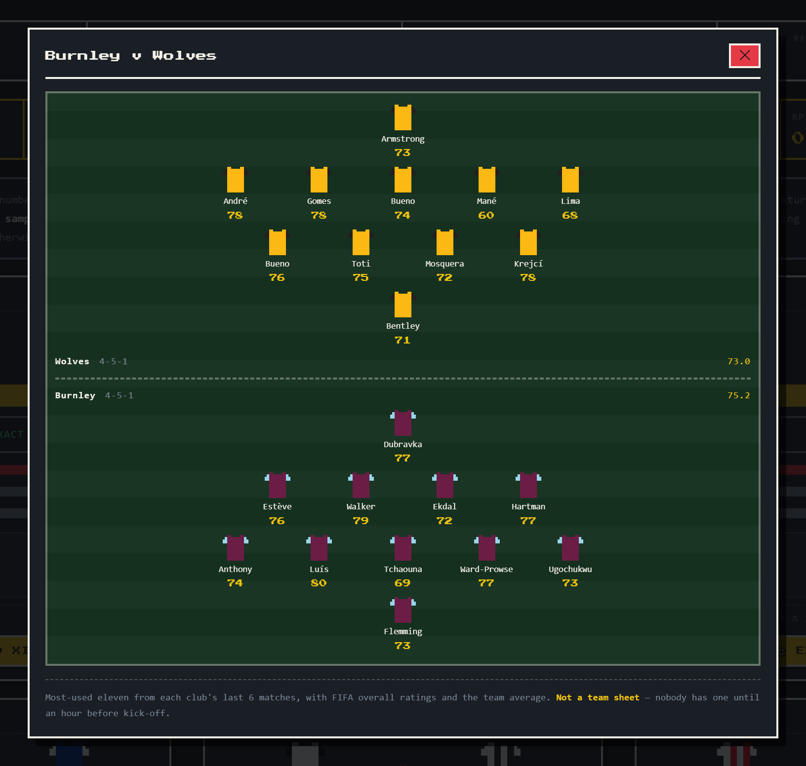

# Premier League Match Prediction

### [→ See this week's predictions](https://mk-premier-league-match-prediction.streamlit.app/)

[](https://github.com/maciekwolus/premier-league-match-prediction/actions/workflows/ci.yml)
[](https://github.com/maciekwolus/premier-league-match-prediction/actions/workflows/predict-round.yml)

Predicts the **scoreline** of upcoming Premier League fixtures, with probabilities — and
shows every prediction next to the bookmaker's line, so it is obvious whether the model is
actually adding anything.

**The site updates itself.** A scheduled job predicts each round a few days before it kicks
off, commits it, and the page redeploys — so what you are looking at was written *before*
those matches were played, and is never rewritten afterwards.

```
Crystal Palace vs Arsenal     0-1 (14%) · 0-2 (13%) · 1-1 (11%)
                              Home 15% | Draw 24% | Away 61%
                              Bookmaker: 24% | 26% | 51%
```

## Why this exists

**It is a workout for Claude Code, disguised as a football project.** The predictions are
real, but the point was to see how an AI coding agent copes with a project long enough to
outlive its own memory.

- **A written plan.** [PLAN.md](PLAN.md) holds the scope; every session starts by reading it.
- **Instructions that outlive the conversation.** [CLAUDE.md](CLAUDE.md) carries the rules
  and the traps.
- **Parallel subagents**, one per season, on work that was genuinely parallel.
- **A branch and a PR per phase.** Nothing reached `main` unread.
- **Skills** for the workflows that recur — see [SKILLS.md](SKILLS.md).
- **UI checked by measuring the page**, never by reading the code.

The most useful lesson had nothing to do with football: **a feature with passing tests can
be connected to nothing at all.** A whole squad-adjustment mechanism was built, tested and
documented before anyone noticed that nothing called it.

## What it does

Seven seasons of results are joined to the **players who actually started each match**, and
those players are matched to their FIFA ratings — so the model knows not just that Arsenal
are playing, but which Arsenal turned up. Rolling form, expected goals, Elo and rest days
go in alongside. A set of goals models turns that into two expected-goals numbers per
fixture, which become a full scoreline probability matrix.

| Input | Source |
|---|---|
| Results, shots, cards, odds | [football-data.co.uk](https://www.football-data.co.uk/englandm.php) |
| Lineups and expected goals | [Understat](https://understat.com) |
| Player ratings | FIFA 20–23 / EA Sports FC 24–26 |

**Trained on 2019/20 through 2025/26 — 2,660 matches, 99 features, 9 models benchmarked.**
It predicts **2026/27**: the twenty clubs and all 380 fixtures come from the Fantasy
Premier League API rather than from results that do not exist yet, and clubs promoted into
the division get an eleven built from ratings, since there is no history here to read one
from. Results are ingested as the season is played, which is what lets the report score
itself.

Squads are kept honest against reality rather than against last season. Expected XIs come
from who a club has actually been starting, then anyone the **Fantasy Premier League squad
lists** no longer show at that club is dropped — Casemiro played all of 2025/26 for Man
United and was still being picked a year after leaving. Suspensions come out of cards
already on disk. A signing has no appearances to rank against, so one takes a place only
when rated clearly above the weakest player in the same line.

Every prediction is **archived the moment it is made and never rewritten**, because the
only interesting question about a forecast is what it said *before* the match — and that
cannot be reconstructed afterwards.

## The report



Styled after a teletext results page. Each card gives the most likely scorelines, the
home/draw/away split, and where the model **disagrees with the market by more than ten
points** — the only genuinely interesting thing a model can offer once a market exists.
Club crests are trademarked, so each side gets a pixel kit instead, generated as inline SVG.

Once more than one round is stored a **season and round picker** appears, and any round that has
been played shows the final score on each card with a verdict — including `EXACT SCORE`
alongside `WRONG CALL` when the scoreline landed but the headline call did not, which is
the normal case rather than an edge one.

Played rounds also carry a season-to-date scorecard putting our RPS next to the
bookmaker's **over the same fixtures**. Under thirty scored matches it says plainly that
this is not a sample — and if that small sample happens to beat the market, it says not to
believe it and points at the 2,280-match backtest instead. (The screenshot above is the
opening round of 2026/27, which nobody has played yet, so it carries neither.)

Every card opens an **expected XI** — both sides on a pitch, attackers meeting at the
halfway line, with each player's FIFA rating and the team average. This is where the
squad-quality signal stops being a number in a table:



## Does it beat the bookmaker?

**No — and that is the correct result.** Ranked Probability Score, walk-forward over 2,280
matches, lower is better:

| | RPS |
|---|---|
| **bookmaker (closing odds)** | **0.1965** |
| gbm-with-odds | 0.2027 |
| poisson-glm | 0.2039 |
| baseline-elo | 0.2051 |
| dixon-coles-squad *(what the report shows)* | 0.2087 |
| baseline-league-average | 0.2346 |

*A selection; [CLAUDE.md](CLAUDE.md) carries all ten.*

A model that beat the closing line should be suspected of data leakage before it is
believed. Two things worth noticing: **plain Elo beats AutoGluon on 85 features**, and the
report deliberately does *not* use the best model without odds — `poisson-glm` wins on RPS
by hedging, which makes it call 1-1 in 74% of matches. When the deliverable is a scoreline,
that is a failure whatever the score says.

**The table above trains every model on complete seasons only, so they are compared on
equal footing — the deployed model does better than its row.** It also learns from the
season being played, which is worth 0.2087 → **0.2033** over the same 2,280 matches, nearly
twice what the whole squad-quality channel buys. A frozen table forecasts October
from each club's strength in May, and a promoted club is worse than stale: Coventry and
Hull appear in none of the seven training seasons, so both were handed the league average
and the model could not tell them apart. It is not bought by hedging, either — the 1-1
share *falls* and the number of distinct scorelines rises.

Learning from a season as it is played does mean fitting a promoted club on one match, which
once produced a 10-0. Clubs seen only a handful of times are now held towards the league
average, an effect that fades out by half a season, so established sides are left alone. That
takes the deployed model to **0.2028**, and its real value is what can no longer be published.

Worth noting how that was settled, since the first answer was wrong: measured over the
first eight rounds of 2026/27, the change looks like a **loss**. Seventy matches
is the region where the real effect is a twentieth of the noise, which is the same reason
the report refuses to let a good round speak for itself.

## Would it have made money?

**No, in any of the three bets, in any season.** Every one of the 2,280 backtested matches
gets all three, with Poland's 12% stake tax deducted: 10 zł on the outcome the model rates
most likely, 10 zł on its leading scoreline, and 10 zł on **each** of its three likeliest
scorelines. That last one is three bets and 30 zł a match, of which at most one can win, so
it stakes 68,400 zł where the other two stake 22,800 zł each.

| Season | Home/draw/away | Hit | Exact score *(estimated prices)* | Hit | Top three *(estimated prices, 30 zł a match)* | Hit |
|---|---:|---:|---:|---:|---:|---:|
| 2020/21 | -706 zł | 51.1% | -1,741 zł | 9.2% | -4,550 zł (-39.9%) | 27.9% |
| 2021/22 | -612 zł | 53.9% | -1,998 zł | 8.4% | -3,209 zł (-28.1%) | 33.2% |
| 2022/23 | -680 zł | 52.4% | -1,621 zł | 10.0% | -3,756 zł (-32.9%) | 31.1% |
| 2023/24 | -461 zł | 57.4% | -903 zł | 12.1% | -4,408 zł (-38.7%) | 26.3% |
| 2024/25 | -443 zł | 55.5% | -776 zł | 12.9% | -3,077 zł (-27.0%) | 31.6% |
| 2025/26 | -904 zł | 46.8% | -1,218 zł | 11.3% | -3,821 zł (-33.5%) | 30.0% |
| **Total** | **-3,807 zł (-16.7%)** | 52.9% | **-8,257 zł (-36.2%)** | 10.7% | **-22,821 zł (-33.4%)** | 30.0% |

Compare these by return, not by balance, because the top three stakes three times as much.
One of its scorelines lands in 30.0% of matches against 10.7% for the single score, nearly
three times as often, but that is what the prices already charge for: 684 of its 6,840 bets
won, and per złoty it is only slightly better, -33.4% against -36.2%. On three times the
stake, that makes it the largest loss of the three. It is not a safer way to win.

Even with the tax removed, home/draw/away still loses 5.3%, about what a bookmaker's margin
takes on its own, so the picks add little beyond the favourite the market already prices.
The exact score still loses 27.5% and the top three 24.3%.

That table is this README's record of the backtest, and it is not on the site. The report
runs the same three bets on every live round and shows the current season only, and the
balance updates itself as results come in. If a balance climbs above zero, one sentence
quotes the backtest's loss beside it, so a lucky run does not get to speak for itself.

**These are not Polish bookmaker prices.** The aim was STS, but the only archive holding its
prices forbids automated collection, so home/draw/away uses Bet365's real closing odds, and
exact-score and top-three odds are **estimated** from that line with a 25% bookmaker margin.
Neither is a price anyone was actually quoted. That assumption moves the exact-score total
between -6,993 zł at 15% and -9,335 zł at 35%, and the top three between -18,857 zł and
-26,197 zł, and both stay heavy losses throughout.

## Running it

It is already running at
**[mk-premier-league-match-prediction.streamlit.app](https://mk-premier-league-match-prediction.streamlit.app/)** —
nothing to install if you only want to look at it.

To run it yourself: **[SETUP.md](SETUP.md) — how to install and run the whole app**, from a
fresh clone to the report on screen.

Already built? Then it is two lines, and the `cd` is the one people skip:

```bash
cd C:\repositories\premier-league-match-prediction
```
```bash
.venv\Scripts\python.exe -m streamlit run app.py
```

## Also here

| File | What it is |
|---|---|
| [SETUP.md](SETUP.md) | Install and run the whole app, step by step |
| [COMMANDS.md](COMMANDS.md) | Every command and flag, plus what the error messages mean |
| [PLAN.md](PLAN.md) | The build plan, all three stages, and where each phase landed |
| [CLAUDE.md](CLAUDE.md) | Architecture contracts, leakage rules, and the data quirks worth knowing |
| [SKILLS.md](SKILLS.md) | The four Claude Code skills in this repo, and when to reach for each |

```
src/config.py     seasons, paths, source URLs — the single place seasons are defined
src/data/         acquisition and cleaning, one module per source
src/matching/     name reconciliation between sources
src/features/     squad quality, form, Elo, and the feature table
src/models/       goals models and the scoreline matrix
src/evaluate/     scoring, walk-forward backtesting, the bookmaker benchmark
src/predict/      fixtures, expected XIs, squad currency, and the prediction archive
src/report/       shaping predictions for display
src/betting/      the simulated 10 zł bets: prices, settlement, the backtest and the tracker
app.py            the Streamlit report
tests/            558 tests, no network access and no reading of data/
data/manual/      hand-written overrides: names, ratings, absences, fixtures (committed)
```

**Status: complete, and running unattended.** Stage one built the pipeline; stage two made
it survive a live season — archived predictions, a scored history, suspensions, and squads
for clubs the data has never seen; stage three put it online and left it alone, with a
daily job that predicts each round before kickoff, commits it, and redeploys the page.
Only what the deployed site and that job need is committed; the rest is gitignored and
rebuilt from source.

## Built with

**Python 3.12.** [requirements.txt](requirements.txt) is small, quick and free of hard
version pins — which is what makes it safe to deploy. The two awkward dependencies are
separate, in [requirements-full.txt](requirements-full.txt), and all 558 tests pass with
both absent. This is what each one is here for.

| | | |
|---|---|---|
| **Data** | `pandas`, `numpy` | Every stage is a dataframe; parquet on disk between them |
| | `pyarrow` | The parquet reader and writer |
| **Sources** | `requests` | football-data CSVs, the Fantasy Premier League API |
| | `understatapi` | Per-match lineups and expected goals *(separate: it hard-pins urllib3)* |
| **Matching** | `rapidfuzz` | Player names across three sources that spell them differently |
| **Models** | `scipy` | Optimises Dixon-Coles — the model the report actually uses |
| | `autogluon.tabular` | Gradient boosting *(separate: ~700 MB)*. `compare --fast` runs without it |
| **Report** | `streamlit` | The page. Cards are hand-written HTML; Streamlit does layout |
| **Tooling** | `pytest`, `ruff` | 558 tests, lint and format — run on every push by [GitHub Actions](.github/workflows/ci.yml) |

**No neural network was written by hand** — that was a constraint from the start.
Dixon-Coles is a well-defined statistical model fitted with `scipy.optimize`, and AutoGluon
handles the machine learning behind a `.fit()`.

**Not used, deliberately.** No database: parquet files are faster at this size and need
no server. No web framework: the report is a single Streamlit script. **Every data source is
free**, and the one that needs an account — Kaggle, for the player ratings — is placed by
hand rather than automated around, because credentials are the user's to handle.
